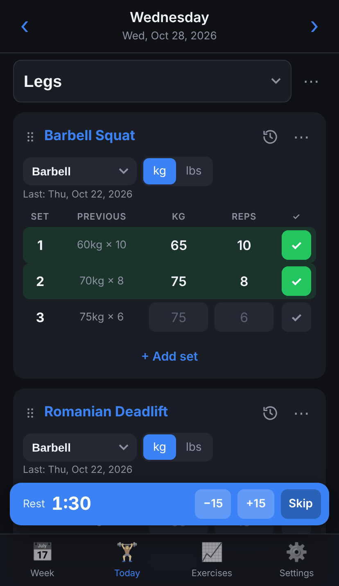
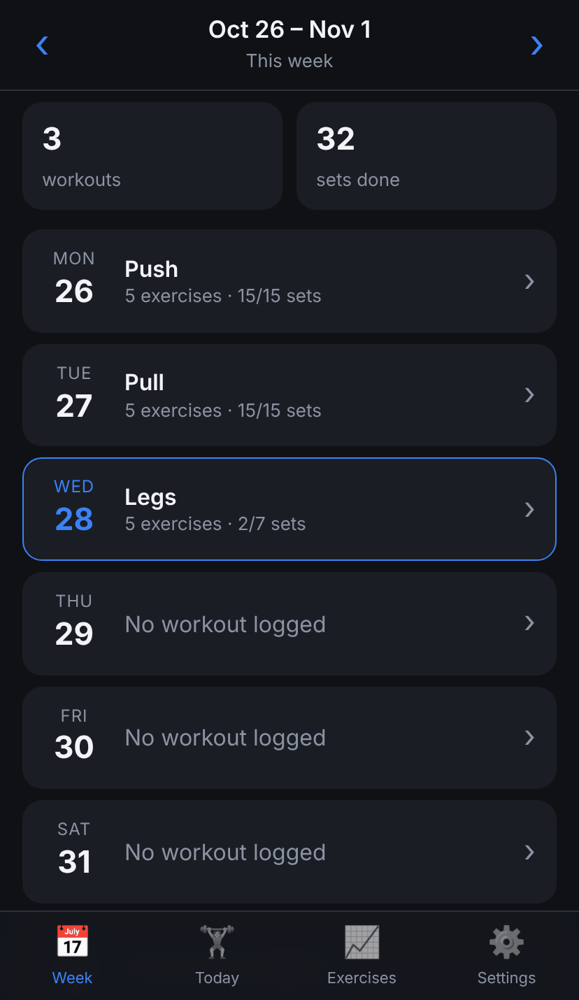
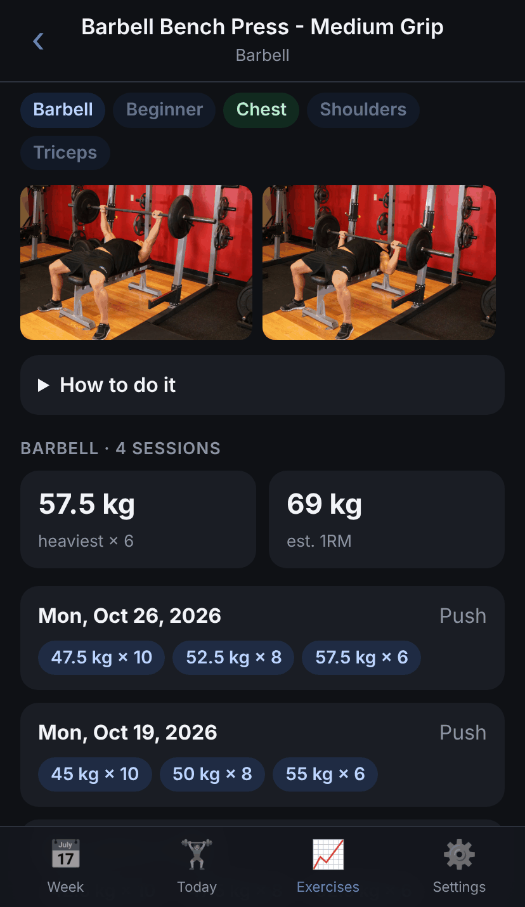
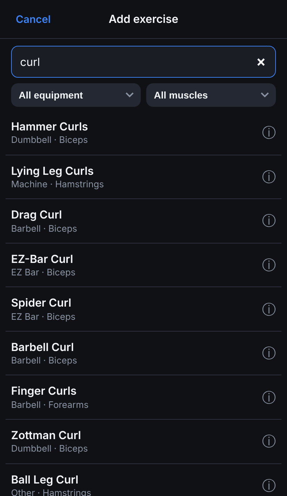
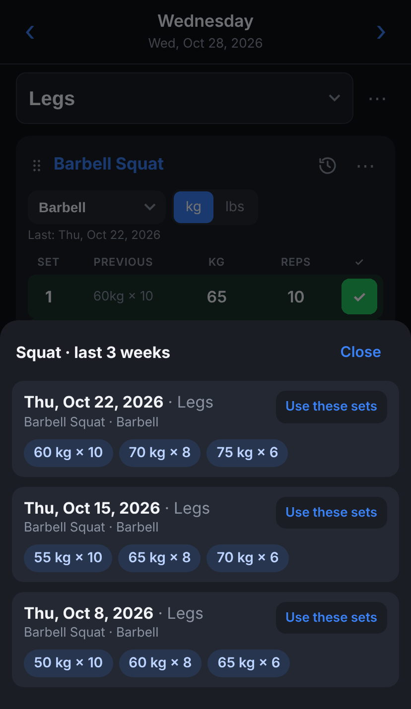

<div align="center">


# TMF Workout Tracker

**A free, open-source gym log for your phone. Works offline, needs no account, and your data never leaves your device.**

[**▶ Open the app**](https://the-muscle-factory.github.io/tmf-pwa/) · [Install on your phone](#install-on-your-phone) · [Features](#features) · [Privacy](#privacy)

[](LICENSE)






</div>

## Why

Most workout apps want an account, a subscription, or your data on their servers. TMF is a **progressive web app**: one web page you add to your home screen, after which it behaves like a native app.

- **Free and open source.** No ads, no paywall, no tracking.
- **Private by design.** Everything is stored on your phone, in your browser's storage. There is no server and no sign-up.
- **Offline.** It works in a basement gym with no signal.
- **Fast to log.** Last time's numbers sit next to every set, so you only type what changed.

## Install on your phone

Open **https://the-muscle-factory.github.io/tmf-pwa/** and:

| iPhone / iPad (Safari) | Android (Chrome) | Desktop (Chrome / Edge) |
|---|---|---|
| Tap **Share → Add to Home Screen** | Tap **⋮ → Install app** | Click the **install** icon in the address bar |

Open it once with internet so it can save itself for offline use. **Settings → Works offline** shows **Ready ✓** when it's done.

## Features

**Logging**
- **Week view** with Monday–Sunday weeks: what you trained each day and how many sets you did.
- **Workout types:** Push, Pull, Legs, Upper/Lower Body, Arms, Abs & Core, Full Body, Cardio, Rest, or your own.
- **Repeat last workout:** one tap brings back the exercises from your last Push (or Pull, or Legs…) day.
- **Sets as rows** of weight + reps. Reps accept things like `8+2` for rest-pause.
  - **Drop sets** are marked **D** and record just the starting weight.
  - **Cardio** records minutes, km and a note (speed, incline, level).
- **PREVIOUS column:** last time's numbers for the same exercise, equipment and cable ratio. Tap to copy them, or tick ✓ to fill in blanks.
- **Rest timer** starts when you tick a set (1:00 to 3:00, or off).
- **Equipment** per exercise (barbell, dumbbell, cable, machine…), **cable ratio 1:1 / 2:1**, and **kg / lbs**.

**Exercises**
- **870+ exercises** with search and filters by equipment and muscle. You can add your own too.
- **Exercise pages:** muscles worked, photos, step-by-step instructions, and your history with heaviest set and estimated 1RM.
- **Recent sets:** the clock icon shows the last 3 weeks of that movement (e.g. every squat variation), with **Use these sets** to copy a session into today.

**Editing**
- Swipe an exercise left to delete it (with **Undo**). Drag the ⠿ handle to reorder.
- **Couldn't do:** mark a planned exercise as skipped with a short note. When you repeat that workout, it comes back with a **Skipped last time** tag.
- Templates, day notes, clear a whole workout (with Undo).
- **Backup:** export everything to a JSON file and import it on another phone, either merging or replacing.

<p align="center">


</p>

## Privacy

- Your workouts are stored **only** on your device, in IndexedDB. Nothing is sent anywhere, and there are no analytics.
- The only network requests are for loading the app itself and, when you're online, exercise photos from the free-exercise-db repository on GitHub.
- Deleting the app from your home screen deletes its data. Use **Settings → Export** for a backup.

## Run it yourself

No build step: it's plain HTML, CSS and JavaScript modules.

```sh
git clone https://github.com/The-Muscle-Factory/tmf-pwa.git
cd tmf-pwa
python3 -m http.server 8000   # then open http://localhost:8000
```

**Host your own copy:** fork the repo, then go to **Settings → Pages → Source: GitHub Actions** and push to `main`. `.github/workflows/pages.yml` deploys it to `https://<you>.github.io/tmf-pwa/`.

When you change shipped files, bump `VERSION` in `sw.js` so installed apps pick up the update on their next launch.

### Code layout

```
index.html, manifest.webmanifest, sw.js   app shell, install metadata, offline cache
js/app.js        hash router + startup
js/db.js         IndexedDB wrapper              ┐
js/store.js      days, templates, settings      │ data layer
js/library.js    exercise dataset + search      │ (no DOM code)
js/legacy.js     upgrades older saved data      │
js/dates.js      date helpers                   ┘
js/dom.js        h() element helper, dialogs, toasts
js/gestures.js   swipe to delete, drag to reorder
js/timer.js      rest timer
js/views/*.js    screens: week, day, exercise picker/info, history, settings
data/exercises.json   exercise library (rebuild: python3 tools/build-exercises.py)
```

## Contributing

Issues and pull requests are welcome, whether bug reports, ideas or fixes. A few house rules:
- Keep it dependency-free and build-free.
- Keep the data layer free of DOM code.
- If you change the saved data's shape, add an upgrade path so existing data on people's phones keeps working.

## Credits

The exercise library (names, equipment, muscles, instructions and photos) comes from **[free-exercise-db](https://github.com/yuhonas/free-exercise-db)** by [yuhonas](https://github.com/yuhonas). That project builds on the original **[exercises.json](https://github.com/wrkout/exercises.json)** dataset by [Ollie Jennings](https://github.com/OllieJennings). Both are released into the public domain under the [Unlicense](https://unlicense.org/). Thank you!

- `data/exercises.json` is a trimmed copy reshaped for this app: equipment is mapped to the app's own list, and unused fields are dropped. `tools/build-exercises.py` regenerates it from upstream.
- Exercise photos aren't copied into this repo. They load from free-exercise-db's GitHub-hosted images when you're online, which is how that project documents using them.
- The screenshots use made-up demo data.

## License

[MIT](LICENSE). Free to use, change and share, with credit.
